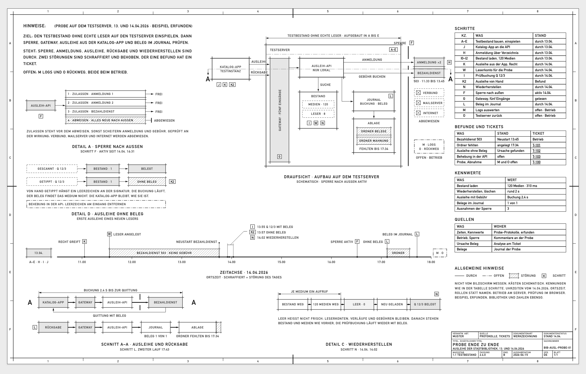
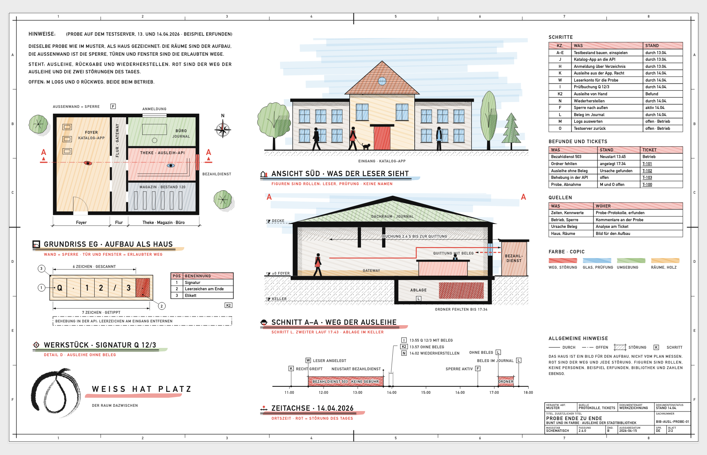
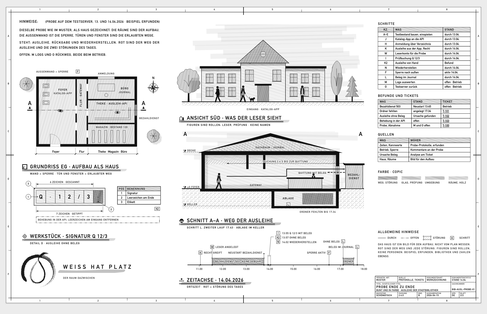
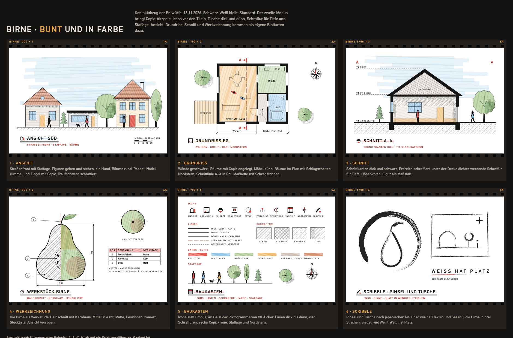
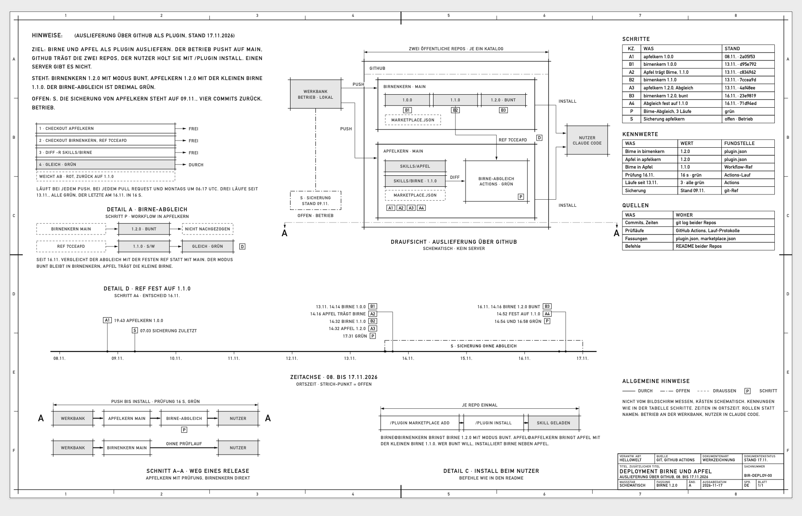
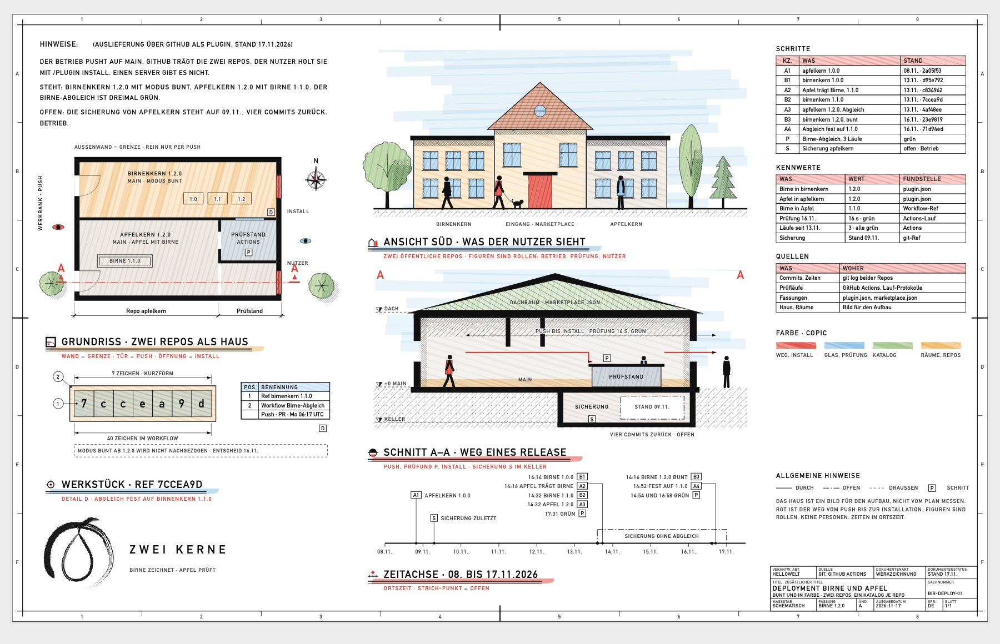
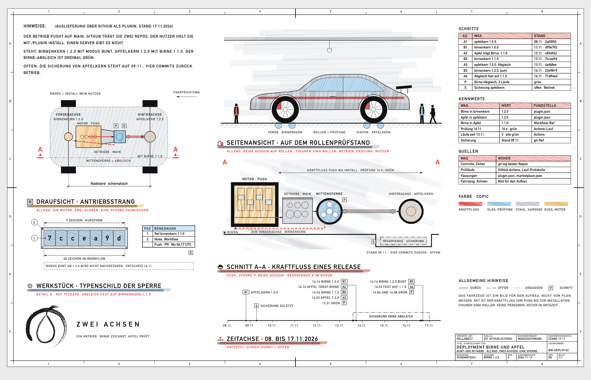

# birnenkern

[English](README.md) · **Deutsch**



```text
┌──────────────────────────────────────────────────────────────────────────────┐
│  ◆  BIRNE                                                 Sachnummer BIR-01  │
│     zeichnet, wie etwas gebaut ist und welchen Weg es nimmt.         Änd. A  │
├──────────────┬──────────────┬──────────────┬─────────────────────────────────┤
│  ANSICHTEN 6 │  LINIEN    8 │  NORMEN    5 │  1 Blatt · 1700 × 1060          │
│  Draufsicht  │  Voll        │  ISO 5457    │  Rahmen mit Zonen A–F, 1–8      │
│  Schnitt     │  Strich-Punkt│  ISO 7200    │  Schriftfeld unten rechts       │
│  Zeitachse   │  Schraffiert │  ISO 128     │  Tusche auf Weiß, keine Farbe   │
├──────────────┴──────────────┴──────────────┴─────────────────────────────────┤
│  Jede Zahl hat eine Quelle. Rollen statt Namen. Türlich.                     │
└──────────────────────────────────────────────────────────────────────────────┘
```

**Birne ist ein Skill für Claude Code, der zeichnet.** Wie ein System gebaut ist, welchen Weg eine
Anfrage nimmt, was wann geschah, wo ein Vorhaben steht. Kein buntes Diagramm, sondern ein technisches
Blatt nach DIN, Tusche auf Weiß, wie es im Maschinenbau, in der Architektur oder in der Elektrotechnik
an der Wand hängt.

> Die Striche tragen die Bedeutung, nicht die Farbe. Voll ist durch, Strich-Punkt ist offen,
> schraffiert ist Störung.

## Was Birne zeichnet

| Ansicht | Zeigt |
|---|---|
| **Draufsicht** | wie es gebaut ist, mit Schnittlinie A–A |
| **Schnitt** | den Weg einer Anfrage oder eines Klicks, Ende zu Ende |
| **Detail** | eine Stelle vergrößert |
| **Explosionsansicht** | Ebenen übereinander |
| **Zeitachse** | einen Tag oder einen Klick mit fester Skala, Störungen schraffiert |
| **Tabellen** | Schritte, Befunde mit Tickets, Kennwerte, Quellen |

Dazu Rahmen mit Zonen und Mittenmarken (DIN EN ISO 5457), kleines Schriftfeld unten rechts
(DIN EN ISO 7200), Linienarten statt Farbe (DIN EN ISO 128), Beschriftung in DIN 1451, Kanten leicht
überzeichnet, Texte im Blocksatz. Nur Grau, nur hell, druckt auf A3 quer.

## Bunt und in Farbe



Grund ist Schwarz-Weiß. Wer Farbe will, sagt `birne bunt`: dann kommen Copic-Akzente, Icons vor den Titeln, Tusche
dick und dünn, Schraffur für Tiefe und Staffage dazu, also Bäume, Figuren, ein Hund und ein Nordstern. Das Blatt zeigt
den Aufbau als Haus, wie im Bauwesen: Ansicht, Grundriss, Schnitt A–A und ein Werkstück. Figuren sind Rollen, Rot
ist der Weg und die Störung. Ohne Farbe gedruckt bleibt alles lesbar, jede Farbe wird zu Grau.

| Dasselbe Blatt ohne `modus('bunt')` | Kontaktabzug der Entwürfe |
|---|---|
|  |  |

## Unser eigenes Deployment, dreimal

Wie Birne und Apfel zum Nutzer kommen, von Birne selbst gezeichnet: Push auf main, GitHub trägt beide Repos,
`/plugin install` holt sie. Jede Zahl stammt aus `git log`, den Läufen in GitHub Actions oder aus `plugin.json`.
Grund ist Schwarz-Weiß. Das Haus ist der Modus bunt, wie er ausgeliefert wird. Der Allrad-Antriebsstrang auf dem
Rollenprüfstand ist ein Entwurf für ein zweites Bild im Modus bunt (Motor = Push, Mittensperre = Abgleich fest auf
1.1.0, zwei Achsen = zwei Repos).

| Schwarz-Weiß | Bunt, als Haus | Bunt, als Antriebsstrang (Entwurf) |
|---|---|---|
|  |  |  |

Die Blätter selbst liegen als HTML in `docs/deployment/`.

## Befehle

| Du tippst | Birne macht |
|---|---|
| `birne` | fragt, was aufs Blatt soll und woher der Stoff kommt |
| `birne <thema>, Stoff in <datei>` | zeichnet, sieht einmal hin, bessert einmal nach, öffnet das Blatt |
| `zeichne das als Blatt` | dasselbe aus jedem Gespräch |
| `technisches Blatt auf Englisch …` | Blatt auf Englisch, mit `sprache('en')` |
| `birne bunt …` | Blatt im Modus „Bunt und in Farbe“, mit `modus('bunt')` |

Das Blatt landet als `birne-<thema>-<datum>.html` im Arbeitsordner und öffnet sich im Browser.

## Grundsätze

- **Jede Zahl hat eine Quelle.** Protokoll, Ticket, Commit. Was nicht belegt ist, kommt nicht aufs Blatt.
- **Rollen statt Namen.** Keine Personen, keine Kürzel, keine Hostnamen, keine internen Pfade.
- **Keine erfundenen Maße.** Proportionen schematisch.
- **Ein Blatt.** Nicht zwei, keine Folien.
- **Einmal hinsehen.** Rendern, Überlappungen suchen, einmal nachbessern. Keine Schleife.

## Einbauen

```text
/plugin marketplace add rdo2hellowelt/birnenkern
/plugin install birne@birnenkern
```

Braucht Claude Code und einen Browser. Ohne DIN 1451 lädt das Blatt Barlow Semi Condensed von Google Fonts.

## Birne und Apfel

[Apfel](https://github.com/rdo2hellowelt/apfelkern) prüft Arbeitsdialoge und zeichnet seine Befunde auf
diesem Blatt. Das Plugin apfel trägt die kleine Birne, schwarz-weiß, Stand 1.1.0. Den Modus bunt gibt es nur
hier: wer ihn will, lädt Birne zu Apfel dazu.

## Lizenz

MIT, © 2026 Hans M. Das Zeichenwerkzeug folgt
[dimensional-drawing](https://github.com/enesozturk/dimensional-drawing) von enesozturk (MIT).
Die Normen sind nur sinngemäß wiedergegeben.

---

<sub>Gebaut mit Stolz bei hellowelt. Türlich.</sub>
