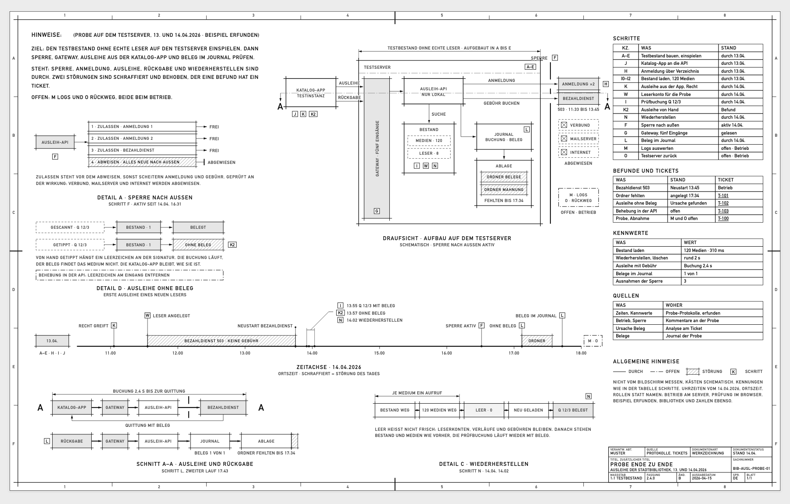
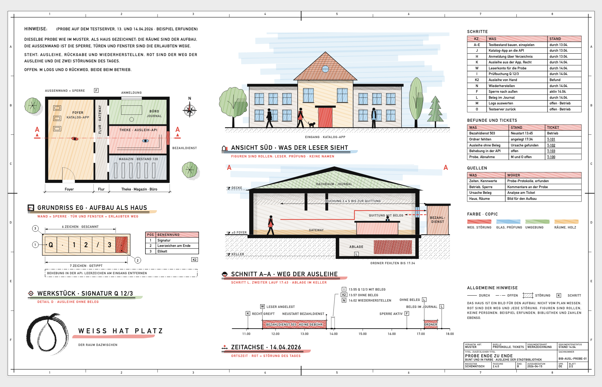
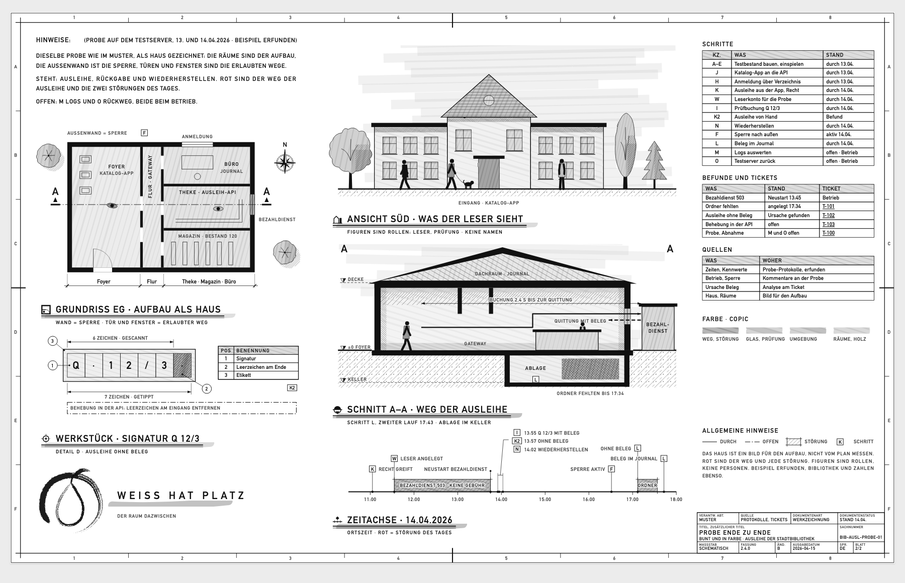
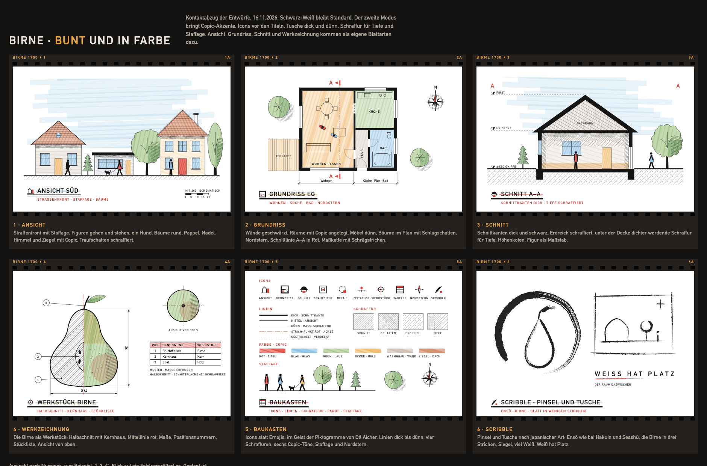

# birnenkern

**English** · [Deutsch](README.de.md)



```text
┌──────────────────────────────────────────────────────────────────────────────┐
│  ◆  BIRNE                                                Drawing No. BIR-01  │
│     draws how things are built and which way they go.                 Rev A  │
├──────────────┬──────────────┬──────────────┬─────────────────────────────────┤
│  VIEWS     6 │  LINES     8 │  NORMS     5 │  1 sheet · 1700 × 1060          │
│  Plan view   │  Solid       │  ISO 5457    │  Frame with zones A–F, 1–8      │
│  Section     │  Dash-dot    │  ISO 7200    │  Title block bottom right       │
│  Timeline    │  Hatched     │  ISO 128     │  Ink on white, no colour        │
├──────────────┴──────────────┴──────────────┴─────────────────────────────────┤
│  Every number has a source. Roles, not names. Türlich.                       │
└──────────────────────────────────────────────────────────────────────────────┘
```


**Birne is a Claude Code skill that draws:** how a system is built, which way a request goes, what
happened when, where a project stands. Not a diagram with colours but a technical sheet after DIN,
ink on white, the kind an engineer, an architect or an electrician would hang on the wall.

> The lines carry the meaning, not the colour.
> Solid is done, dash-dot is open, hatched is broken. That's the whole trick.

Birne speaks German by default. `sprache('en')` switches a sheet to English; the terms in *italics*
below are the words you'll see on a German sheet. A short German README is in [README.de.md](README.de.md).

---

## What it draws

A system is a machine. You don't paint it, you draw it: from above, cut open along the path that
matters, one spot enlarged, and a timeline underneath.

| View | Shows | For example |
|---|---|---|
| **Plan view** (*Draufsicht*) | how it is built, with section line A–A | services behind a firewall, a dialog with its fields |
| **Section** (*Schnitt*) | the path one request or one click takes | app → gateway → API → payment, end to end |
| **Detail** (*Detail*) | one spot, enlarged | firewall rules in order, one button before and after |
| **Exploded view** (*Explosionsansicht*) | layers on top of each other | modal over table over page |
| **Timeline** (*Zeitachse*) | a day or a click on a fixed scale | outage hatched, events with an ID |
| **Tables** (*Tabellen*) | steps, findings with tickets, figures, sources | every number with its source |

## Line types instead of colour

| Line | Means |
|---|---|
| solid | built, done, a part |
| solid, grey fill | control, field, fixed block |
| dashed | placeholder, empty area |
| dash-dot | open, proposal, target |
| hatched | blocked, fault, missing, overwritten |
| wide | path in a section, barrier, timeline |
| thin dash-dot | section line, centre line |
| thin with arrow | flow, dimension |

Grey only, light only. The sheet prints on A3 landscape. Colour only when you ask for it, see below.

## Bunt und in Farbe



Black and white is the ground. Say `birne bunt` and the sheet gets marker accents (Copic), icons in front of the
titles instead of emojis, thick and thin ink, hatching for depth, and some life: trees, figures standing and walking,
a dog, a north star. The system is drawn as a house, the way architects do it: elevation (*Ansicht*), floor plan
(*Grundriss*), section A–A (*Schnitt*) and one part as a workshop drawing (*Werkstück*). Walls are the boundary,
doors are the allowed paths, figures are roles. Red is the path and the fault. Printed without colour it still
reads: every colour turns to grey.

| The same sheet without `modus('bunt')` | Contact sheet of the drafts |
|---|---|
|  |  |

## The sheet

```text
 ┌─────1─────────2─────────3─────────4─────────5─────────6─────────7─────────8──────┐
 A  NOTES: what it shows,             PLAN VIEW                       TABLES        A
 │  what stands, what is open    ── A ─────────────── A ──            steps         │
 B                                                                    findings      B
 │  DETAIL A                                                          figures       │
 C                                                                    sources       C
 │  DETAIL B                                                                        │
 D  TIMELINE ─────────────────────────────────────────────            GENERAL NOTES D
 │                                                                    line types    │
 E  SECTION A–A                     DETAIL C                                        E
 F                                                               ┌ TITLE BLOCK ─┐   F
 └─────1─────────2─────────3─────────4─────────5─────────6───────┴─7─────────8──┴───┘
```

Frame with zones and centring marks (DIN EN ISO 5457), small title block bottom right
(DIN EN ISO 7200), line types (DIN EN ISO 128), lettering in DIN 1451 where installed, otherwise
DIN Alternate, Bahnschrift or Barlow Semi Condensed. Square corners, edges slightly overdrawn,
like a ruling pen. Text set justified.

## Commands

| You type | Birne does |
|---|---|
| `birne` | Asks what goes on the sheet and where the material comes from |
| `birne <subject>, material in <file>` | Draws the sheet, looks at it once, fixes it once, opens it |
| `zeichne das als Blatt` | Same, from any conversation |
| `technisches Blatt auf Englisch …` | Sheet in English |
| `birne bunt …` | Sheet in colour mode, with `modus('bunt')` |

The sheet lands as `birne-<topic>-<date>.html` in the working folder and opens in the browser.

## Principles

- **Every number has a source.** Log, ticket, commit. What isn't backed doesn't go on the sheet.
- **Roles, not names.** No people, no initials, no host names, no internal paths.
- **No invented dimensions.** Proportions are schematic; numbers only when they are documented.
- **One sheet.** Not two, not a slide deck.
- **No self-correction on the sheet.** It shows the state, not how it got there.
- **Look once.** Render, look for overlaps, fix once. No loop.

## Install

**As a plugin** (recommended, with updates), in Claude Code:

```text
/plugin marketplace add rdo2hellowelt/birnenkern
/plugin install birne@birnenkern
```

**As a plain skill**, without the plugin:

```sh
git clone https://github.com/rdo2hellowelt/birnenkern ~/birnenkern
cp -R ~/birnenkern/skills/birne ~/.claude/skills/birne
```

Needs: Claude Code and a browser. Chrome or Edge in headless mode lets Birne look at the sheet
before it opens it.

## Birne and Apfel

[Apfel](https://github.com/rdo2hellowelt/apfelkern) reviews the browser dialogs people work in and
draws its findings on this sheet. The Apfel plugin carries the small Birne, black and white, as of
version 1.1.0. The colour mode lives only here: install Birne next to Apfel if you want it.

## Under the hood

```text
birnenkern/
├─ .claude-plugin/        plugin.json · marketplace.json · icon.png
├─ docs/                  example sheets for this README, icon source, drafts of the colour mode
└─ skills/birne/
   ├─ SKILL.md            when · steps · the sheet · lines · text · content · toolkit
   ├─ assets/             blatt-vorlage.html: toolkit, sheet, colour mode, made-up example
   │                      beispiel-bunt.html: the same example in colour mode
   ├─ references/din.md   the norms in short, building drawings included
   ├─ evals/evals.json    10 test cases: when it triggers, when it doesn't
   ├─ QUELLEN.md          origin, license and changes
   └─ LICENSE · LICENSES/
```

## Thanks

The drawing toolkit follows [dimensional-drawing](https://github.com/enesozturk/dimensional-drawing)
by enesozturk (MIT), in `skills/birne/LICENSES/`. Frame, title block, justification, ink and the colour mode are Birne's own. The brush lettering uses
Yuji Syuku from Google Fonts (SIL Open Font License).

## License

MIT, © 2026 Hans M. See `LICENSE`.

DIN and ISO norms are only paraphrased; the norm texts are not part of this repo.

---

<sub>Gebaut mit Stolz bei hellowelt. Proud of it? Türlich. Türlich Türlich Digga.</sub>
